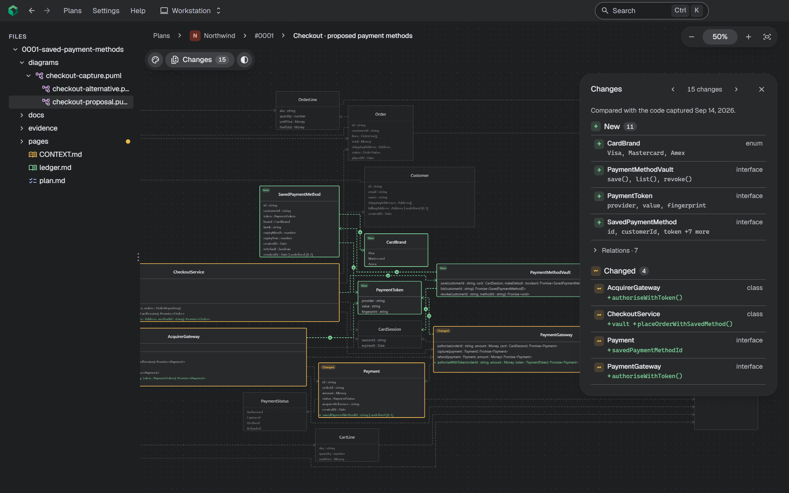

<picture>
  <source media="(prefers-color-scheme: dark)" srcset="assets/coord-horizontal-on-dark.svg">
  <source media="(prefers-color-scheme: light)" srcset="assets/coord-horizontal-on-light.svg">
  
</picture>

**Coord is where your coding agents' plans live.** When you design something with an agent, the plan, its steps, the decisions behind it and the diagrams that explain it are written into a planning folder on your computer instead of disappearing with the chat. Every agent session that works in your project finds them again, keeps them current as it works, and you follow all of it in one desktop app.

![The Coord hub, dark, on the computer Workstation: three open plans of the project Northwind, grouped as Your turn (Saved payment methods, with what the agent waits on you for: choose how a customer picks a saved card, on the card picker page; Claude Opus 5.5 and two other models, its agent time and tokens), Waiting (Customer order notifications, with why it is blocked) and Later (Order fulfilment model), each with its steps done, its agents and when it changed; the title bar holds the Coord mark, Plans, Settings and Help, the computer menu and the search, and the heading line the project menu, Statistics and the Open, Closed and All filter](assets/hub.png)

## Why bother

Coding agents are good at doing work and bad at remembering it. A plan agreed in one conversation is gone in the next; decisions end up scattered across chats, PR descriptions and your memory; and with several agents at once you lose track of what each one is doing and what is waiting for you.

Coord fixes that without changing how you work with your agent:

- **Plans that survive the session.** A work item is a plan, its steps and its glossary, in a Git repository of its own. The next session, the next agent or the next model starts from what was agreed, not from scratch.
- **One place to see everything.** The hub lists every plan of every project by whose turn it is: **Your turn** first, each saying what you are to do (merge this PR, try that), then what agents work on, what waits on something else, and what comes later. Agents keep it true: they say whose turn it is as they start and stop, and point out work you forgot.
- **An agent that plans before it codes.** For work big enough to plan, the agent asks before opening a work item, questions you one decision at a time until the design is settled, and only then implements it, step by step, through pull requests and review.
- **Diagrams that match the code.** Coord captures TypeScript and Java code and SQLite, PostgreSQL and D1 databases as class and entity diagrams, draws agents' proposals against them, and compares the system before and after a plan.
- **Numbers on how agents work.** For every work item, Coord measures agent time, tokens, models and subagents, for planning and for implementation, so you can see what a feature cost and how a new model does on your work.
- **Yours, on your computer.** Plans are Markdown in Git, in your home folder. No account, no service and no API key; nothing leaves your computer unless you pair another device of yours.

## How it works

1. **Plan.** Tell your agent what you want. When it is big enough to plan, it asks to open a work item, interviews you ("grill me" for a thorough round), and writes the plan as the answers settle. You accept it.
2. **Implement.** Say "coord implement". The agent starts the accepted plan with its steps, marks each one as it goes, reviews its work, and delivers it the way the plan says: commits, a branch, or a pull request that passes CI. When the work is done, it closes it, asking you first unless you handed it over to finish without you.
3. **Follow along.** Coord shows the plan with its summary, its steps and what is left, the diagrams under the headings they explain, the sessions that worked on it, and what it cost.

![A plan in Coord, dark: Saved payment methods, #0001 of Northwind, under the breadcrumb Plans › Northwind › #0001, marked Your turn with what to do: choose how a customer picks a saved card, on the card picker page, which is linked below the title; its Outcome and Scope, and the current checkout with links into its captured TypeScript model. At the left the plan's files, plan.md marked and the pages folder with a dot for the page that needs you; at the right the side column: Progress (2 of 7 steps done, 5 left), Continues #0004 Inventory reservations at checkout, the steps, and Statistics (Claude Opus 5.5 with Claude Sonnet 4.5 and Claude Haiku 5.5, 4 h 8 min of agent time, 13.8M tokens); Search in the title bar](assets/plan.png)

Coord works with **Claude Code** and **Codex** through its plugin: tools for the planning state, three skills (`coord`, `coord-grill` and `coord-implement`) with the delivery skills beside them (full send, full stop, babysitting and reviewing a PR), and hooks that check every planning edit and measure the session as it works. You never have to tell the agent to update its plan or report its time.

## What else it does

- **Statistics.** Agent time, completed plans and the time they took, the work over time by model, and the models and reasoning effort used, per project or for every project.

  

- **Diagrams.** Coord's own PlantUML subset, laid out and drawn by Coord, with a change view for proposals and comparisons.

  

- **Find past work by tag.** Agents tag each work item with the release it ships in and the areas it touches, so `tag:0.8.0` in the search, or asking an agent, lists everything done for 0.8.0.
- **Share a plan** as one offline HTML file that anyone can open in a browser, and import it into another project.
- **Work from another computer.** Pair your laptop with your workstation over Tailscale and switch between their projects in the title bar.

## Get started

Coord runs on **Windows** and **Linux**, with **Claude Code** or **Codex**.

1. **Install the app**: the Windows installer or the Linux AppImage from a [GitHub Release](https://github.com/envsemble/coord/releases). See [installing the app](app/README.md#install). The app brings everything else: the `coord` command, which it puts on your PATH, and the Coord plugin for your agents.
2. **Connect your agents.** On its first start, Coord asks which of Claude Code and Codex to connect and installs its plugin into them; **Settings › Agents** does it later.
3. **Start planning.** Open a new agent session in one of your repositories and ask "What is Coord and how do I use it?", or describe what you want to build. The agent creates a project for the folder when you plan there.

To work on Coord itself, or to run the command from a checkout instead, see [the coord command](docs/command.md#install) and [CONTRIBUTING](CONTRIBUTING.md#set-up-and-run).

## Learn more

- [App guide](app/README.md): the hub, plans, projects, statistics, diagrams and windows.
- [Agent interface](docs/agent-interface.md): the plugin, its tools, skills and hooks.
- [Progress and statistics](docs/progress-and-statistics.md): steps, and what Coord measures and how.
- [Diagrams](docs/diagrams.md): the PlantUML subset, captures, proposals and comparisons.
- [Remote access](docs/remote-access.md): work on another computer's projects.
- [The coord command](docs/command.md) and [all documentation](docs/README.md).
- [Contributing](CONTRIBUTING.md), the [changelog](CHANGELOG.md) and [third-party notices](THIRD_PARTY_NOTICES.md).

Coord is open source under the [MIT license](LICENSE). It covers the code, not the Coord and envsemble names, logos or icons, which remain envsemble's.
