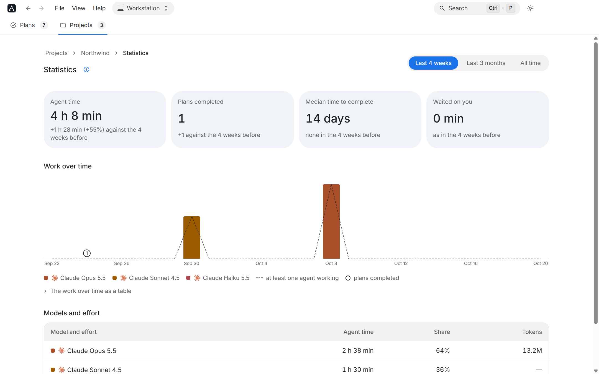

<picture>
  <source media="(prefers-color-scheme: dark)" srcset="assets/atlas-banner-dark.svg">
  <source media="(prefers-color-scheme: light)" srcset="assets/atlas-banner-light.svg">
  
</picture>

[](https://github.com/envsemble/atlas/actions/workflows/ci.yml)
[](CHANGELOG.md)
[](THIRD_PARTY_NOTICES.md)

**Atlas is where your coding agents' plans live.** When you design something with an agent, the plan, its steps, the decisions behind it and the diagrams that explain it are written into a planning folder on your computer instead of disappearing with the chat. Every agent session that works in your project finds them again, keeps them current as it works, and you follow all of it in one desktop app.


## Why bother

Coding agents are good at doing work and bad at remembering it. A plan agreed in one conversation is gone in the next; decisions end up scattered across chats, PR descriptions and your memory; and with several agents at once you lose track of what each one is doing and what is waiting for you.

Atlas fixes that without changing how you work with your agent:

- **Plans that survive the session.** A work item is a plan, its steps and its glossary, in a Git repository of its own. The next session, the next agent or the next model starts from what was agreed, not from scratch.
- **One place to see everything.** The hub lists every plan of every project: what is in progress, what is blocked, what is still a draft. A plan shows **Working** while an agent is on it and **Needs you** once it waits for your answer.
- **An agent that plans before it codes.** For work big enough to plan, the agent asks before opening a work item, questions you one decision at a time until the design is settled, and only then implements it, step by step, through pull requests and review.
- **Diagrams that match the code.** Atlas captures TypeScript and Java code and SQLite, PostgreSQL and D1 databases as class and entity diagrams, draws agents' proposals against them, and compares the system before and after a plan.
- **Numbers on how agents work.** For every work item, Atlas measures agent time, tokens, models and subagents, for planning and for implementation, so you can see what a feature cost and how a new model does on your work.
- **Yours, on your computer.** Plans are Markdown in Git, in your home folder. No account, no service and no API key; nothing leaves your computer unless you pair another device of yours.

## How it works

1. **Plan.** Tell your agent what you want. When it is big enough to plan, it asks to open a work item, interviews you ("grill me" for a thorough round), and writes the plan as the answers settle. You accept it.
2. **Implement.** Say "atlas implement". The agent starts the accepted plan with its steps, marks each one as it goes, and delivers through pull requests with review and CI.
3. **Follow along.** Atlas shows the plan with its summary, its steps and what is left, the diagrams under the headings they explain, the sessions that worked on it, and what it cost.


Atlas works with **Claude Code** and **Codex** through its plugin: tools for the planning state, three skills (`atlas`, `atlas-grill` and `atlas-implement`), and hooks that check every planning edit and measure the session as it works. You never have to tell the agent to update its plan or report its time.

## What else it does

- **Statistics.** Agent time, completed plans and the time they took, the work over time by model, and the models and reasoning effort used, per project or for every project.

  

- **Diagrams.** Atlas's own PlantUML subset, laid out and drawn by Atlas, with a change view for proposals and comparisons.

  

- **Share a plan** as one offline HTML file that anyone can open in a browser, and import it into another project.
- **Work from another computer.** Pair your laptop with your workstation over Tailscale and switch between their projects in the title bar.

## Get started

Atlas runs on **Windows** and **Linux** and needs **Node 24**, npm and Git.

1. **Install the `atlas` command** from a clone and set Atlas up for your agents. The clone needs a token for Envsemble's private envUI package; [CONTRIBUTING](CONTRIBUTING.md#set-up-and-run) shows how.

   ```sh
   npm ci
   npm link --workspace @envsemble/atlas
   atlas setup
   ```

   `atlas setup` creates the Atlas home (`~/.atlas`) and installs the Atlas plugin into Claude Code and Codex. Start a new agent session afterwards.

2. **Install the app**: the Windows installer or the Linux AppImage from a [GitHub Release](https://github.com/envsemble/atlas/releases), or `npm run package` in the clone. See [installing the app](app/README.md#install).
3. **Create a project** on the app's **Projects** page: give it a name and the folders where you work on it, such as your repositories. Or just ask your agent to create one.
4. **Start planning.** Open an agent session in one of the project's folders and describe what you want to build.

## Learn more

- [App guide](app/README.md): the hub, plans, projects, statistics, diagrams and windows.
- [Agent interface](docs/agent-interface.md): the plugin, its tools, skills and hooks.
- [Progress and statistics](docs/progress-and-statistics.md): steps, and what Atlas measures and how.
- [Diagrams](docs/diagrams.md): the PlantUML subset, captures, proposals and comparisons.
- [Remote access](docs/remote-access.md) and [plan export](docs/plan-export.md).
- [The atlas command](docs/command.md) and [all documentation](docs/README.md).
- [Contributing](CONTRIBUTING.md), the [changelog](CHANGELOG.md) and [third-party notices](THIRD_PARTY_NOTICES.md).

Source is currently private (`UNLICENSED`): a source-use status, not an open-source license.
