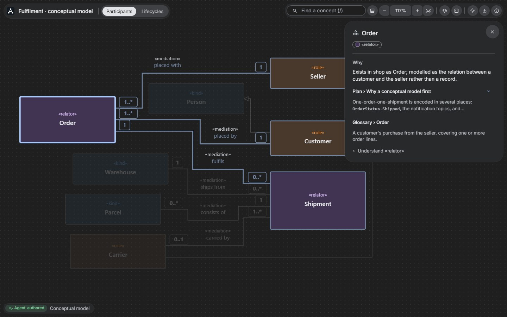

<picture>
  <source media="(prefers-color-scheme: dark)" srcset="assets/atlas-banner-dark.svg">
  <source media="(prefers-color-scheme: light)" srcset="assets/atlas-banner-light.svg">
  
</picture>

[](https://github.com/envsemble/atlas/actions/workflows/ci.yml)
[](CHANGELOG.md)
[](docs/releases.md)
[](THIRD_PARTY_NOTICES.md)

Atlas keeps plans, decisions and models in a place both a coding agent and its human can read. Plans, ledgers, glossaries, ADRs and evidence live in a versioned `planning` folder. Next to each plan, the agent keeps models: dated captures of database or class structure, and the conceptual UML/OntoUML proposals built on them. The human reads all of it in the Atlas app. The agent edits through the `atlas` command, its MCP server and the Atlas skills.

[Start](#start) · [The atlas command](#install-the-atlas-command) · [Skills](skills/README.md) · [App](app/README.md) · [Agent interface](docs/agent-interface.md) · [Embedding](docs/embedding.md) · [Export/reopen](docs/portable-documents.md) · [Comparison](docs/comparison.md) · [Learning reports](docs/learning-reports.md) · [PR/MR review](docs/review-ci.md)


| Part                                          | What it does                                                                                                                        |
| --------------------------------------------- | ----------------------------------------------------------------------------------------------------------------------------------- |
| [App](app/README.md)                          | Reads a planning folder: work items, plans, ledgers, knowledge, Git activity, usage statistics and each plan's diagrams. Read-only. |
| [`atlas` command](#install-the-atlas-command) | Model tools, the MCP server, planning checks and consultation logging, for agents and scripts.                                      |
| [Skills](skills/README.md)                    | Seven `atlas-*` agent skills for setting up, grilling, implementing, recording and organizing plans, and for modeling.              |
| [Diagram package](packages/diagrams)          | Captures, validates, lays out and renders models, and exports self-contained offline HTML. Used by the app and the command.         |
| [Planning reader](packages/planning)          | The planning-folder reader shared by the app and the command.                                                                       |

## Start

Use **Node 24**, npm and Git. Java extraction also needs **JDK 21**, and PostgreSQL capture needs a supported PostgreSQL 17 schema.

```sh
npm ci
npm run dev --workspace @envsemble/atlas-app
```

Open `http://127.0.0.1:4317/`. The app reads the `planning` folder next to this checkout; pass `-- --planning-dir /path/to/planning` to read another, or switch folders from the sidebar. Plans, models and statistics stay local, and no model service or API key is needed. The [app guide](app/README.md) covers its views, diagrams and usage statistics.

Each work item keeps its models in its own folder (`<work>/.atlas/`), so a plan, its ledger and its diagrams move together. Plans show a card under every heading a diagram explains, and each diagram is labelled **Generated from code**, **Generated from database**, **Agent proposal** or **Agent-authored**.

## Install the atlas command

One `atlas` command covers the model tools, the MCP server, planning checks and consultation logging. It needs only Node 24. From a checkout:

```sh
npm ci
npm link --workspace @envsemble/atlas-cli
atlas --version
```

`npm link` puts `atlas` on the PATH (Windows and Linux) as a link to this checkout, so keep the checkout in place; it always runs the checkout's current code. `npm rm --global @envsemble/atlas-cli` removes it. Inside the checkout, `npx atlas …` works without linking.

```text
atlas model <operation> --root <workspace> [--input <request.json|->]
atlas model review --input <request.json|->
atlas model tools
atlas model job <init|validate|build> ...
atlas mcp --root <workspace>
atlas planning check <planning-root>
atlas usage log <planning-root> --files <path>... [--task <id>] [--session <id>] [--data-dir <dir>]
```

Model commands print JSON and exit 2 for input failures and 1 for blocking findings. `atlas planning check` is read-only and exits 0 when valid, 1 on errors and 2 on usage errors. `atlas usage log` always exits 0, so a logging problem never fails an agent's task; unrecorded reports leave a coverage marker and a note on stderr.

Usage statistics and recent planning folders live in the per-user **Atlas data folder**: `%APPDATA%\Atlas` on Windows, `${XDG_CONFIG_HOME:-~/.config}/Atlas` on Linux, or `ATLAS_DATA_DIR` when set. Statistics are kept per planning folder under `usage/<hash of its canonical path>/`; nothing is written into planning folders.

## Skills

The [Atlas skills](skills/README.md) work in Codex and Claude Code and name no model or provider. Install them next to the `atlas` command:

| Skill                                       | Purpose                                                                      |
| ------------------------------------------- | ---------------------------------------------------------------------------- |
| [atlas-bootstrap](skills/atlas-bootstrap)   | Create or adopt a planning repository with governance and explicit scope.    |
| [atlas-organize](skills/atlas-organize)     | Organize retained plans and evidence without losing originals.               |
| [atlas-grill](skills/atlas-grill)           | Clarify a design and record shared understanding as it settles.              |
| [atlas-implement](skills/atlas-implement)   | Implement an explicitly selected plan through review and CI.                 |
| [atlas-record](skills/atlas-record)         | Retain useful outcomes, decisions and scoped knowledge.                      |
| [atlas-babysit-pr](skills/atlas-babysit-pr) | Carry existing PRs through the repository's review gate and current-head CI. |
| [atlas-model](skills/atlas-model)           | Capture, author, revise, validate and reopen models while planning.          |

`atlas-implement` and `atlas-babysit-pr` run only when invoked by name.

## Models

Capture declared database or class structure as a dated baseline, author a conceptual proposal over it, inspect the semantic changes and export a reopenable offline HTML document. The viewer is read-only; the agent edits through the library, the command or MCP.



| Adapter                                | Supported input                                                               | Fidelity / limits                                                                                                       |
| -------------------------------------- | ----------------------------------------------------------------------------- | ----------------------------------------------------------------------------------------------------------------------- |
| [PostgreSQL](docs/database-capture.md) | PostgreSQL 17; explicit schemas, read-only repeatable-read capture            | Catalog tables, columns, keys and supported declared constraints; metadata visibility must be sufficient.               |
| [SQLite](docs/database-capture.md)     | SQLite 3.45+ (<4) through Node 24; main namespace                             | Declared schema with affinity/collation/count limits; captures never read application rows.                             |
| [D1](docs/database-capture.md)         | Separately tested local Wrangler path; explicit query executor for remote use | Repeated matching metadata passes, with weaker consistency disclosed; no account discovery or deployment.               |
| [TypeScript](docs/code-capture.md)     | Packaged 6.0.3 compiler; explicit tsconfig/projects and dependencies          | Named declarations, own members, inheritance/realization/type use; dynamic/framework behavior remains outside coverage. |
| [Java](docs/code-capture.md)           | JDK 21; explicit files/classpath; processing disabled                         | Compiler declarations, records, own members and declared type use; no build scripts or annotation processors.           |

Bounds: database 200 tables / 4,000 columns / 8 MiB metadata; code eight projects / 200 selected files / 500 declarations / 4,000 members / 8 MiB selected text, with additional compiler-input limits. Missing prerequisites fail explicitly; exclusions or unresolved facts disclose partial coverage. Unknown runtime counts use `?`. Imported provenance remains a retained claim, not a new verification.

- Standard [OntoUML exchange JSON](https://github.com/OntoUML/ontouml-schema) and versioned [Atlas documents](docs/architecture.md) keep model semantics separate from scenes and UI.
- The [atlas command and stdio MCP server](docs/agent-interface.md) persist models under `.atlas`, enforce expected revisions and return focused bounded results.
- [Proposals](docs/comparison.md) retain frozen baselines. Baseline/Changes share positions; three-way conflicts remain explicit until resolved. Cross-layer mappings are authored links.
- In the app, elements link to the plan passages, glossary entries, decisions and code evidence they explain, and plans link back to them.
- [Learning reports](docs/learning-reports.md) include walkthroughs, finite scenario checks, glossary, source dates, coverage, SVG diagrams and printing. Exported HTML can be imported and revised later.


`npm run dev` starts the diagram viewer alone at `http://127.0.0.1:5173/` with React/Vite live updates. `npm run build` produces `packages/diagrams/index.html`, `packages/diagrams/downloads/` and the reusable React module; the HTML opens directly from disk (or with `npm run preview` at port 4173) and needs no internet or model service. The enrollment example includes valid instances and counterexamples; the R5 example in [index.html](packages/diagrams/index.html) uses pinned public Season 3 sources and preserves three ontology findings for investigation.

```sh
node packages/diagrams/scripts/build-enrollment.cjs artifacts/enrollment --report
```

### Library and React

Inside Atlas, the app and the command use the private `@envsemble/atlas-diagrams` workspace package directly. Elsewhere, create a local package with `npm pack` in `packages/diagrams`, then install the tarball. Core Node APIs use CommonJS or default ESM import:

```js
import atlas from "@envsemble/atlas-diagrams";
const document = atlas.importDocument(exportedHtml);
const proposal = atlas.createProposal(document);
const payload = (
  await atlas.prepareViewer({ document: proposal, includeArtifacts: false })
).payload;
const built = await atlas.buildViewer({ document: proposal });
atlas.writeViewer(built, "./site");
```

```jsx
import {
  AtlasPanel,
  ViewerErrorBoundary,
} from "@envsemble/atlas-diagrams/react";
import "@envsemble/atlas-diagrams/embedded.css";

<ViewerErrorBoundary>
  <AtlasPanel
    payload={payload}
    theme="dark"
    onReference={openPlanningPassage}
  />
</ViewerErrorBoundary>;
```

Size the host container; React 19.3 is a peer dependency. [Embedding](docs/embedding.md) documents focus, theme, updates and containment. [Viewer behavior](docs/viewer.md) covers smooth local camera movement, amber focus, hideable details, Shiki previews and generic orthogonal layout.

## Validate and distribute

The validator integrates the official schema with reference/ownership/count checks and a documented subset of OntoUML rules. It does not establish domain accuracy or full ontology model checking. [Rule coverage](docs/architecture.md) and [finite-example limits](docs/learning-reports.md) remain visible. Guidance paraphrases the [OntoUML specification](https://ontouml.readthedocs.io/en/latest/).

```sh
npm run format:check
npm run check:types
npm test
npm run test:skills
npm run build
npm run check
npm run check:package
npm run check:performance
npm run check:review
npm run review:example -- artifacts/review
npm run check:release
```

Full database tests require `ATLAS_TEST_POSTGRES` pointing to a disposable PostgreSQL 17 fixture. CI runs these checks on Linux and Windows and builds revision-labelled [review artifacts](docs/review-ci.md) and versioned [release ZIPs](docs/releases.md). No release is published or deployed. Clean-package checks exercise Node/React, actual TS/Java capture and offline output; export/reopen has dedicated fixtures.

[Contributing](CONTRIBUTING.md) · [Changelog](CHANGELOG.md) · [Release instructions](docs/releases.md) · [Repository history maps](docs/history/README.md) · [Third-party notices](THIRD_PARTY_NOTICES.md)

Source is currently private / `UNLICENSED`. This is a source-use status, not an open-source license. Editable branding lives in `assets/` (the app and viewer icon in `packages/diagrams/assets/`); dependency licenses and attributed example excerpts remain preserved.
