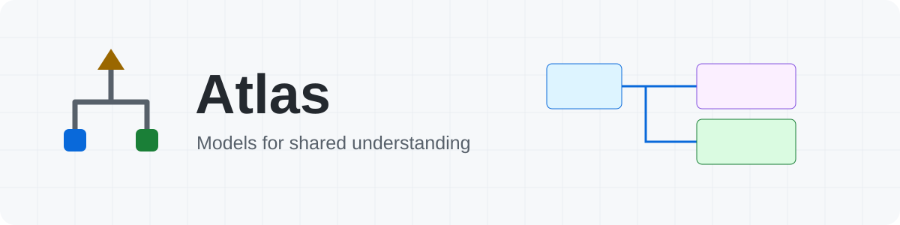
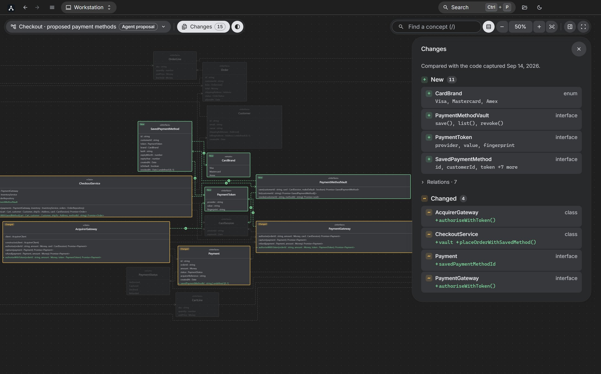

<picture>
  <source media="(prefers-color-scheme: dark)" srcset="assets/atlas-banner-dark.svg">
  <source media="(prefers-color-scheme: light)" srcset="assets/atlas-banner-light.svg">
  
</picture>

[](https://github.com/envsemble/atlas/actions/workflows/ci.yml)
[](CHANGELOG.md)
[](docs/releases.md)
[](THIRD_PARTY_NOTICES.md)

Atlas keeps plans, decisions and diagrams where both a coding agent and its human can read them. Plans, ledgers, glossaries, ADRs and evidence live in versioned planning folders in the Atlas home on your computer. The agent works on them through the Atlas plugin for its harness: planning-state tools, three skills, and hooks that check its edits and measure its work without being asked. The human follows along in the Atlas desktop app.

[Get started](#get-started) · [App guide](app/README.md) · [Agent interface](docs/agent-interface.md) · [The atlas command](docs/command.md) · [Progress and statistics](docs/progress-and-statistics.md) · [Remote access](docs/remote-access.md) · [All documentation](docs/README.md)


| Part                                 | What it does                                                                                                                                                      |
| ------------------------------------ | ----------------------------------------------------------------------------------------------------------------------------------------------------------------- |
| [App](app/README.md)                 | The desktop app for Windows and Linux: one hub with every plan of every project, and each plan with its ledger, knowledge, Git activity, statistics and diagrams. |
| [Plugin](docs/agent-interface.md)    | The Atlas plugin for Claude Code and Codex: the MCP server, the `atlas`, `atlas-grill` and `atlas-implement` skills, and the hooks.                               |
| [`atlas` command](docs/command.md)   | Planning-state operations, checks, the MCP server and hooks, setup, plan export and import, and the headless host, for agents and scripts.                        |
| [Diagram package](packages/diagrams) | Reads and checks diagrams, captures code and databases, lays out and renders diagrams, and exports offline HTML. Used by the app and the command.                 |
| [Planning reader](packages/planning) | The planning-folder reader and planning operations shared by the app, the host and the command, including [plan export and import](docs/plan-export.md).          |
| [Host](packages/host)                | Serves planning folders to the desktop app and, with [remote access](docs/remote-access.md) on, to the devices you pair.                                          |

## Get started

Use **Node 24**, npm and Git. Installing from a clone needs a GitHub token for Envsemble's private envUI package; [CONTRIBUTING](CONTRIBUTING.md#set-up-and-run) shows how. Java capture also needs a **JDK 21** or newer, and PostgreSQL capture needs a supported PostgreSQL 17 schema.

1. **Install the `atlas` command** from a clone of this repository, and set Atlas up for your agents:

   ```sh
   npm ci
   npm link --workspace @envsemble/atlas-cli
   atlas setup
   ```

   `atlas setup` creates the Atlas home (`~/.atlas`), lets Claude Code and Codex sessions edit planning files in it from any checkout, and installs the Atlas plugin into each of them. Start a new agent session afterwards. If you copied earlier Atlas skills (`atlas-*`) into `~/.claude/skills` or `~/.codex/skills`, remove them: the plugin replaces them. The [command reference](docs/command.md) covers every command and the home.

2. **Create a project.** A project is a planning folder in the home that covers workspace folders: an agent session in one of them works in that project and its plans. Create one in the app on the **Projects** page (in the menu) with a name and a folder, ask your agent (the `project_create` tool), or run `atlas project create --name <name> --workspace <folder>`. Atlas registers the Git checkouts it finds in the folder; their remotes find the project from checkouts outside it. `atlas home adopt <folder>` moves a planning folder you already have into the home.
3. **Install the app** from its installer (Windows) or AppImage (Linux), built by CI or by `npm run package`; the [app guide](app/README.md#install) explains both, and what to do when Linux has no [sandbox support](app/README.md#linux-sandbox). Or run it from the clone with `npm run dev`.
4. **Open Atlas.** It opens on the hub: every plan of every project, blocked and in progress first, then drafts, each with its project, a one-line summary, its progress and a live dot while an agent works on it. Filter by project or search, and open a plan in one click; back and forward return to where you were. Atlas follows changes as the agent writes them.

Plans, diagrams and statistics stay on your computer unless you turn on remote access. No model service or API key is needed.

## The plugin and its skills

The [plugin](docs/agent-interface.md) gives an agent everything Atlas needs from it:

- **At session start**, the project for the folder it works in (by workspace folder, else by Git remote), its planning folder and the active work there; outside any project, the projects in the home, to ask which one the work belongs to.
- **MCP tools** for planning state: find the project (or list them all), create a project, create, accept, start, block, close, archive and reopen work, and keep the ledger's steps, from the planning steps onward. Plan bodies, glossaries, decisions and diagrams are files the agent edits directly.
- **Checks** of every planning file it edits, with the problems handed back to fix.
- **Statistics** measured from its session whenever it stops: time, tokens, models and subagents, as planning or implementation.

| Skill                                                     | Purpose                                                                                                                                                                                                                                                                                                                                               |
| --------------------------------------------------------- | ----------------------------------------------------------------------------------------------------------------------------------------------------------------------------------------------------------------------------------------------------------------------------------------------------------------------------------------------------- |
| [atlas](plugin/skills/atlas/SKILL.md)                     | Plan with the agent: it recognizes work big enough to plan, asks before opening a work item, interviews you, and records the plan, glossary and decisions. It also sets up projects, organizes planning folders, and reviews projects and brings them up to date across all of them. It triggers on its own when you mention Atlas or plan something. |
| [atlas-grill](plugin/skills/atlas-grill/SKILL.md)         | Be grilled: the agent interviews you in rounds, one decision at a time with its recommendation, until the design is settled, recording it as it goes. Say "atlas grill" or "grill me".                                                                                                                                                                |
| [atlas-implement](plugin/skills/atlas-implement/SKILL.md) | Implement an accepted plan end to end, through review and PRs, and close the work. Say "atlas implement"; ordinary coding never triggers it.                                                                                                                                                                                                          |

Invoke a skill by its command: `/atlas:atlas`, `/atlas:atlas-grill` and `/atlas:atlas-implement` in Claude Code, `$atlas`, `$atlas-grill` and `$atlas-implement` in Codex.

The skills work in Codex and Claude Code and name no model or provider. A standalone skill for carrying existing PRs through review and CI, [babysit-pr](extras/babysit-pr/SKILL.md), is not part of the plugin: copy `extras/babysit-pr` into `~/.claude/skills` or `~/.codex/skills` to use it.

## How work moves through Atlas

1. **Plan.** When you design something or ask for something large, the agent asks whether to open a work item, then interviews you (in rounds, when you say "atlas grill") and records the plan, its glossary and its decisions as they settle. You accept the plan.
2. **Implement.** When you say "atlas implement" (or use `/atlas:atlas-implement`, `$atlas-implement` in Codex), the agent starts the accepted plan with its steps, marks each `doing` and `done` as it goes, and delivers through pull requests with review and CI. It closes the work once every step is done.
3. **Follow along.** Atlas shows every work item's progress and the steps left, its plan, ledger and decisions, recent commits, and the diagrams that explain it, updating as files change.

   

4. **Learn from it.** The agent keeps the decisions and lessons worth reusing. A project's statistics show each work item's agent time, tokens and subagents for planning and for implementation, and compares completed work by model over time, so you can see how a new model does on your work.

[Progress and statistics](docs/progress-and-statistics.md) explains the ledger's steps, what the hooks measure and how Atlas counts it.

## Share and connect

- **Share a plan.** `atlas plan export <work-id>` (or **Export Plan…** on the plan's page) writes the whole work item to one `.atlas-plan.html` file: plan, ledger, glossary, decisions, evidence, attachments and diagrams with their history. Anyone can open it in a browser to read the plan offline; it makes no network requests and runs none of its contents. `atlas plan import <file>` adds it to another planning folder as new work. See [plan export](docs/plan-export.md).
- **Work on another computer.** **Remote Access…** in the menu lets your other devices work on this computer's projects as if they were local: turn it on, choose the Tailscale address and create a pairing link.
  - On the other device, **Connect to Another Atlas…** in the menu takes the link (it works once, for five minutes).
  - The computer menu in the title bar then switches between computers, each with its projects.
  - `atlas serve` does the same without the app.

  See [remote access](docs/remote-access.md).

## Diagrams

A diagram is a `.puml` file in a work item, in Atlas's subset of PlantUML: a class diagram of concepts or code, an entity diagram of a database, or an object diagram of example instances. The agent writes and edits diagrams like any file, and links each from the plan under the heading it explains; the hooks check them after every edit. `atlas capture` writes captures of TypeScript and Java code (through the compiler) and of SQLite, PostgreSQL and local D1 databases, frozen and dated. A proposal starts as a copy of a capture and shows an intended change, and a capture taken after implementing a plan compares with the one taken before. Atlas lays out and draws every diagram itself, in the app, in plan exports and in offline HTML. See [diagrams](docs/diagrams.md).



## Develop

[Contributing](CONTRIBUTING.md) covers the layout of this repository, the development servers and the checks CI runs. CI runs them on Linux and Windows, including the packaged app's end-to-end tests, and builds versioned [release ZIPs](docs/releases.md). No release is published or deployed.

[Changelog](CHANGELOG.md) · [Release instructions](docs/releases.md) · [Repository history maps](docs/history/README.md) · [Third-party notices](THIRD_PARTY_NOTICES.md)

Source is currently private / `UNLICENSED`. This is a source-use status, not an open-source license. Editable branding lives in `assets/` (the app and viewer icon in `packages/diagrams/assets/`); dependency licenses and attributed example excerpts remain preserved.
