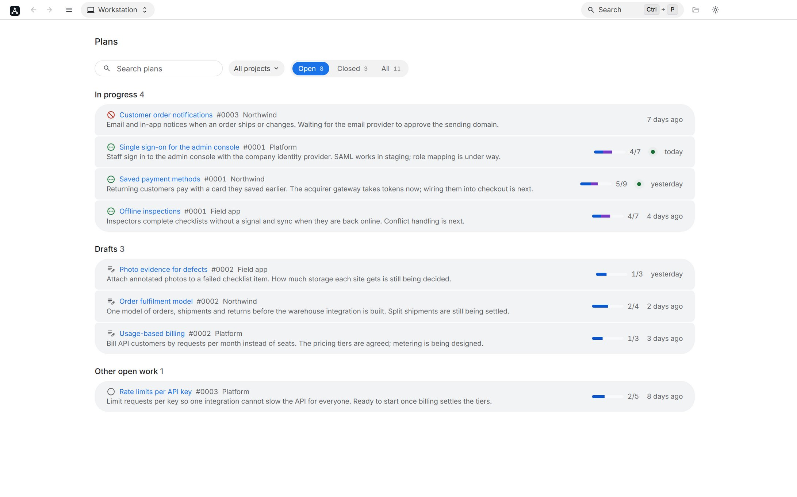

# Atlas desktop app

Atlas is a desktop app for a planning repository: active and archived work, plans, ledgers, glossaries, ADRs, evidence, shared knowledge, Git activity, work and usage statistics and each plan's diagrams. Each planning folder opens in its own window. Discuss changes with your agent in chat; the agent edits the records, and Atlas shows them as they change.

## Install

Atlas is built for Windows and Linux. Builds are unsigned, by decision for a single user; a newer version installs over an older one, and there is no auto-update.

- **Windows:** run `Atlas-Setup-<version>.exe`. SmartScreen warns about an unsigned app the first time: choose **More info › Run anyway**. It installs for the current user only, without administrator rights (you can pick the folder), and adds Atlas to the Start menu. Uninstall it from **Settings › Apps**; your data folder is kept.
- **Linux:** make `Atlas-<version>-x86_64.AppImage` executable (`chmod +x`) and run it.

The installer and AppImage come from the `Desktop` CI job's artifacts, or from `npm run package` in a checkout (they land in `app/release/`).

To open a folder from a terminal or a file manager's "Open with", pass it on the command line: `Atlas.exe C:\work\planning` or `./Atlas-<version>-x86_64.AppImage ~/work/planning`. If Atlas is already running, the folder opens in that instance; a folder that is already open just gets focus.

### Linux sandbox

Atlas keeps Chromium's sandbox on and never disables it. An AppImage cannot use Chromium's setuid sandbox helper, so it needs unprivileged user namespaces. Ubuntu 23.10 and later restrict those through AppArmor; there the AppImage launcher would start Atlas with `--no-sandbox`, and Atlas refuses to run that way: it shows "Atlas does not run without its sandbox" and quits (the log records it too). Allow the namespaces instead, either:

- allow them until the next reboot: `sudo sysctl -w kernel.apparmor_restrict_unprivileged_userns=0` (add `kernel.apparmor_restrict_unprivileged_userns=0` to a file in `/etc/sysctl.d/` to keep it), or
- give the AppImage its own AppArmor profile, `/etc/apparmor.d/atlas-desktop`, then run `sudo apparmor_parser -r /etc/apparmor.d/atlas-desktop`:

      abi <abi/4.0>,
      include <tunables/global>
      profile atlas-desktop /home/*/Applications/Atlas-*.AppImage flags=(unconfined) {
        userns,
        include if exists <local/atlas-desktop>
      }

  Adjust the path to where you keep the AppImage.

Atlas also refuses `--no-sandbox` and `ELECTRON_DISABLE_SANDBOX` given any other way, and its desktop entry never adds them.

## Develop

Requires Node.js 24 or newer, npm, and Git for planning history. From the repository root:

    npm ci
    npm run dev                          # the desktop app, with hot reload
    npm run dev -- C:/path/to/planning   # …opening a planning folder

`npm run dev` runs electron-vite: the window reloads React changes in place, and the app restarts when main-process or preload code changes. There is no browser mode.

    npm run package    # app/release: NSIS installer on Windows, AppImage on Linux
    npm run test:e2e   # Playwright drives the packaged app (run npm run package first)

`npm run package` builds twice from the same output: the release (the installer or AppImage, and the unpacked app in `release/win-unpacked` or `release/linux-unpacked`), with the inspector fuse off, and an otherwise identical unpacked copy in `release/e2e` with it on, because Playwright drives Electron through the inspector. The suite drives `release/e2e`, and `e2e/release.spec.ts` starts the release build itself to check that it opens a folder, has the inspector fuse off, and refuses debugging switches and `--no-sandbox`. Packaging also drops the diagram package's dependencies that only its command-line features use (the MCP server, PostgreSQL and TypeScript capture; `scripts/after-pack.cjs`).

`npm test --workspace @envsemble/atlas-app` runs the unit tests, and `npm run check:types` type-checks the renderer and the main process. The end-to-end suite copies `e2e/fixtures/planning` (a copy of the demo workspace's planning folder) into a temporary Git repository and uses a temporary data folder (`ATLAS_DATA_DIR`), so it never touches your own data. `ATLAS_E2E_UNPACKAGED=1` runs it against `out/` without packaging, and `ATLAS_E2E_INSTALLER=1` also installs and uninstalls the Windows installer (CI does this on a disposable runner).

## Code layout

| Path | What it is |
| --- | --- |
| `main/` | The main process: windows, the menu, the `atlas:` protocol, the message handlers, the log, saved state and the connections to Atlas hosts. It starts this computer's host (`packages/host`, in `main/hostProcess.ts`) in a utility process; the host reads and watches planning folders through `packages/planning` and prepares diagrams with `packages/diagrams`. |
| `preload/` | The bridge: `window.atlas`, one method per message. |
| `shared/` | The message contract and the validator every message argument goes through. |
| `src/` | The React window, built on [envUI](https://github.com/envsemble/envUI) (`@envsemble/envui`): its application shell, tree, document tabs, command palette, menus, dialogs, notices, tables and Material Symbols. `src/atlas.css` lays out Atlas's own regions with envUI tokens only. |
| `e2e/` | The Playwright suite and its fixture planning folder. |

## Windows and folders

Each window shows exactly one planning folder, like VS Code, on this computer or on a computer this one is paired with ([remote access](../docs/remote-access.md)):

- **File › Open Folder…** (Ctrl+O) picks a folder. It must contain a readable `planning.json` with schema version 1; otherwise Atlas explains why and opens nothing. A window without a folder is reused; otherwise the folder opens in a new window, and a folder that is already open gets focus instead. In a window on another computer, it opens that computer's folder browser.
- **File › Open Recent** lists the planning folders of the computer the window works on, newest first, with the window's own folder checked. Choosing one opens it in this window. **Manage Folders…** (there, and on macOS in the system's File menu) lists them all with a button to open each one in a new window (Ctrl+click on a name does the same) and one to remove it from the list.
- **File › Close Folder** takes the window back to the welcome page of its computer. **Close Window** (Ctrl+Shift+W) closes it.
- **The computer menu** (the computer's name in the title bar, after the menus) lists this computer and the paired ones. Choosing a computer works on it in this window: Atlas opens its only folder, the one this device last showed there, its most recent folder, or, with none, that computer's welcome page. On a welcome page, choosing a computer shows its folder list. **Manage Computers…** opens a computer in a new window or forgets a paired one.
- **New Window** (Ctrl+Shift+N) opens an empty window, whose welcome page shows a computer's folder list and Open Folder.
- **The folder list** belongs to the computer: every planning folder opened there, from any device or the command line, stays on it, newest first, until someone removes it, and every device sees the same list.
- Windows open at quit come back on the next start, each with its size, position, sidebar width and visibility, expanded folders, open tabs and the page it showed. Closing windows one by one keeps the last one.
- Two windows may show overlapping folders, such as nested planning roots; each reads only its own folder.

Atlas keeps its own data in the per-user Atlas data folder, shared with the `atlas` command: `%APPDATA%\Atlas` on Windows and `${XDG_CONFIG_HOME:-~/.config}/Atlas` on Linux, or `ATLAS_DATA_DIR`. There it keeps:
- `desktop-state.json`: windows, per-folder layout, and the folder last shown on each computer;
- `usage/`: statistics;
- `host/`: this computer's identity, remote access settings, paired devices, and its folder list (`folders.json`);
- `connections.json`: the computers this one paired with;
- `logs/`;
- `chromium/`: the window engine's own files.

Earlier versions kept recent folders in `planning-roots.json`; the folder list starts from it once. Nothing is written into a planning folder except by an explicit import.

## Layout

The window is envUI's application shell, and it draws its own title bar:

- **Title bar:** the Atlas mark (which also collapses the sidebar), the **File**, **Edit**, **View** and **Help** menus, and the computer menu; then **Search** (quick open), record-health notes when there are any, the theme menu (match the system, light or dark; it applies to every window and to Atlas's own menus and dialogs) and the system's minimize, maximize and close buttons. Empty space in the title bar moves the window, and a double click maximizes it. Alt opens the menus from the keyboard (Alt+F for File). On macOS the menus are in the system's menu bar and the title bar starts after the window buttons. Welcome pages and folder problems have the same title bar.
- **Sidebar:** **Work** (with the number of active work items), **Activity** and **Statistics** are pages of their own: choosing one shows it in place of the open document, and the tabs stay as they are. Below them, the folder's name and the **explorer**: the planning folder as it is on disk, with real folder and file names. Dot folders and build output are hidden. A work folder shows its status icon and, faintly, its plan title; it holds a virtual **Diagrams** entry listing its models with their provenance labels. Only the rows in view are drawn, so large folders stay fast. Arrow keys, Home/End, type-ahead, Enter (open and keep) and Space (preview) work in the tree. A context menu offers **Open Overview**, **Open Diagrams**, **Export Plan…** and **Reveal in File Explorer**, and, anywhere in the explorer, **Collapse All Folders**. Ctrl+B collapses the sidebar to its icons and back; drag its edge, or use the arrow keys on it, to resize it.
- **Tabs** hold the open documents: work items and files. A single click opens a preview tab (in italics) that the next single click replaces; a double click, or working in the tab (choosing a section or a diagram), keeps it. Ctrl+W closes a tab; middle-click closes it too. Closing the last one shows the page again. The tabs stay under the title bar while the page scrolls.
- **A work item** has a bar under the tabs with its place (**Work › #0001**) and its sections, **Plan**, **Ledger** and **Diagrams**, in the same spot for each section. The bar stays while the page scrolls and names the item once its heading scrolls away; the diagrams take the rest of the window.
- **Opening things:** clicking a work folder expands it and opens its overview. Clicking a file opens it in a tab; clicking a diagram opens the Diagrams view focused on it. Links between records open their target in a tab (Ctrl+click keeps it).
- **Quick open** (Ctrl+P, or **Search**) jumps to any work item, diagram or file by name; Enter previews, Ctrl+Enter keeps the tab.

| Shortcut | Action |
| --- | --- |
| Ctrl+P | Quick open |
| Ctrl+B | Collapse or expand the sidebar |
| Ctrl+Shift+E | Show and focus the explorer |
| Ctrl+W | Close the tab |
| Ctrl+O | Open a folder |
| Ctrl+Shift+N | New window |
| Ctrl+Shift+W | Close the window |
| Alt, Alt+F/E/V/H | Open the menus |

## Staying current and recovering

Atlas watches the planning folder instead of polling. Changes are collected for a moment and applied together, so an editor's atomic save, a Git checkout or a commit (which updates Activity) each cause one refresh. The open document, the diagrams and their inline cards follow.

- A **`planning.json` that breaks** while open keeps the last good view, with the error above it; the view recovers as soon as the file is readable again.
- A **folder that is moved or deleted** shows a clear state with **Locate…** (choose its new place; the window keeps its tabs), **Close Folder** (back to the start page) and **Close**. If the folder comes back, the window reopens it.
- A folder that **cannot be read at all** shows why, with the same choices.
- If the folder **cannot be watched** (for example, Linux's inotify watch limit is reached), Atlas says so above the editor and checks for changes every 10 seconds instead. Git objects, dependencies and Atlas's own output folders are never watched. On Linux, Atlas watches each folder itself rather than through Node's recursive watcher, which ignores such failures and leaves part of the tree unwatched.
- A **window that crashes** reloads with its tabs. If it crashes three times within a minute, Atlas asks whether to reload again or close it.

## Import and export

**File › Export Plan…** (also on a work folder's context menu in the explorer) saves a work item as one self-contained HTML file that opens offline in any browser; with no work item open, it first asks which one. **File › Import Plan…** previews such a file (title, original number and origin, the new number and folder, file count and size, diagrams) and only then adds it as new work, without committing. A file that is not a valid export is refused in an error dialog before anything is written. If an import has to be rolled back and some files could not be removed, an error dialog lists them as reported. Both run the [plan export](../docs/plan-export.md) code from `packages/planning` in a worker thread, so large files do not block the window. The export viewer (`packages/planning/viewer`) is built from the same envUI components and shares `src/atlas.css`, the layout of Atlas's own regions, with the app.

## Security and privacy

The app follows Electron's security checklist (the desktop-only decision is work-0011's ADR 0001 in the planning repository):

- The window runs with context isolation and Chromium's sandbox, without Node.js integration, `remote` or `<webview>`.
- The window talks to the main process only through `window.atlas`: a fixed list of messages, each argument checked by `shared/validate.ts`, errors returned as structured values. Messages from any other page or frame are refused.
- A strict content security policy: no inline or remote scripts, no `eval`, and no network connections.
- Each window has its own session whose `atlas:` protocol serves the app and only that window's planning folder, through the same containment as the reader (no paths outside it, no hidden or excluded folders). Every other request is blocked.
- Navigation away from the app and new windows are blocked; web and mail links open in the system browser.
- Commands a page could misuse wait for the person. The main process sees their clicks, key presses and taps in the window, which a page cannot fake:
  - Each press allows one such command.
  - **Edit › Paste** reads the clipboard, so it runs only within two seconds of one (Ctrl+V always works).
  - These also run at once after one:
    - exiting, and closing the last window;
    - opening a window or the logs;
    - turning remote access on, creating a pairing link and pairing with another computer;
    - opening a web address in the browser.

    Otherwise Atlas first asks in a system dialog the page cannot answer, so a screen reader's click, which makes no input event, still works.
  - Dialogs a page opens (choosing a file or folder, About, Locate…) come one at a time.
- Electron fuses turn off running as Node.js and `NODE_OPTIONS`. The installer and AppImage also turn off `--inspect` and its relatives, and refuse to start with `--remote-debugging-port`, `--remote-debugging-pipe` or `--inspect` (they would let other programs control the window); only the separate end-to-end build in `release/e2e` accepts them, for Playwright. The app is not packed into an asar archive (diagram preparation runs esbuild, a native program, over the diagram package's sources), so the archive-integrity fuses are off; they add protection only to signed builds.
- Planning folders are read by the Atlas host in a separate utility process. The main process reaches it over loopback with a token created at each start and kept in memory; windows never reach the host directly.
- No data leaves the machine unless you turn on remote access. Then devices you paired can work on this computer's planning folders as the app does here, and anyone who can reach the chosen address can learn this computer's name and Atlas version. [Remote access](../docs/remote-access.md) describes pairing, tokens, the network and what each computer keeps. There is no telemetry, update check or crash upload.

## Remote access

**File › Remote Access…** lets your other devices work on this computer.
- **On this computer:** choose the address (Tailscale, a local network or this machine) and the port. Then create a five-minute one-time pairing link with a QR code. Its pairing step names the device and may grant **Manage access** (pairing and revoking devices). Revoke devices here too.
- **In a window on another computer:** the dialog manages that computer's pairings, when this device has Manage access there.

**File › Connect to Another Atlas…** (also on the welcome page and in the computer menu) pairs with another computer from its link and lists its planning folders. Then work on it from the computer menu at the top left of the window:
- its folders, through its folder list or folder browser;
- export, and import (the file is sent there);
- document use, counted there.

Only Reveal in File Explorer stays on that computer. See [remote access](../docs/remote-access.md).

## Diagnostics

**Help › Open Logs** opens `logs/` in the data folder: `atlas.log` (the app: start-up, window and connection events) and `host.log` (the Atlas host: folders, the watcher, remote access, pairings and device connections), each 1 MB with up to three older files, including any failures. **Help › About Atlas** shows the version, the Electron, Chromium and Node.js versions and the data folder.

## Records and progress

The reader uses planning.json schema version 1 and the planning workflow's [metadata contract](../skills/atlas-bootstrap/assets/planning/PLANS.md). It follows each registered current_plan pointer. Work without a selected plan retains its original files and an explicit notice; filename order never selects a plan.

Registry locations use POSIX-relative paths. Safe aliases such as ./ prefixes and trailing slashes normalize in memory without rewriting records. Parent segments, absolute paths, backslashes, and duplicate retained work locations produce a clear registry error.

Path comparisons follow the connected folder's case and Unicode-normalization behavior, detected from existing entries without writing probe files. Filesystem aliases retain indexed document spelling and shared collector identities; distinct names remain separate.

Work IDs follow the shared work-0001 format. Explicit selected-plan pointers establish plan ownership; other documents belong to their most-specific registered location in both the viewer and consultation logger. Git activity uses the registry before deletions and after additions, preserving ownership when nested work is archived. Previously unregistered files can use their current registration without overriding established historical owners.

Design acceptance, implementation status, archive location, and known dates are displayed separately. A ledger's steps report its progress; its prose tells what actually happened. Unknown dates stay unknown; invalid dates and chronology generate health errors. Recorded calendar durations are not engineering time. Git activity shows recent checkpoints, associating work through retained registry identities so archiving or renaming its folder preserves earlier activity. Filesystem and Git reads do not update plans or lifecycle state.

Contained Markdown links open their original records. External web references open in the system browser; references outside the planning root are marked. Raw HTML is not executed. Text and common images render in the reader; for other attachments, **Show in folder** reveals the file. The text reader has a 4 MiB limit.

## Statistics

The Statistics view has three tabs. [Progress and statistics](../docs/progress-and-statistics.md) explains what agents report and how Atlas counts it.

- **Work** lists every work item with:
  - its implementing model;
  - the tokens and active time agents reported;
  - its plan revisions;
  - its ledger steps done.

  Totals and the median plan revisions of completed work sit above the list.
- **Models over time** compares completed work by implementing model, the model with the most active time. A chart plots tokens, active time, plan revisions or steps for each completed work item at its completion date, coloured for the three models whose completed work is most recent, with the rest as "Other"; a model keeps its colour while others come and go. A table gives each model's medians. Hover a dot or move through the dots with the arrow keys; click it or press Enter to open the work.
- **Document use** is described below.

A work item's About sidebar shows the same statistics for that work.

Agents report with `atlas work report <planning-root> --work <work-id> --model <id> [--tokens <n>] [--session <id>] [--step <title>]` at ledger transitions, as `atlas-implement` describes. The report is one line in `<work>/.atlas/statistics.jsonl`, so it is versioned and moves with the work folder; plan exports leave it out. The values are self-reported and approximate, and plan revisions need the planning folder's Git history. [Progress and statistics](../docs/progress-and-statistics.md#work-statistics) gives the counting rules: sessions, breaks, token starting points and revisions.

### Document use

Two sources remain distinct: documents opened in Atlas and agent-reported consultation. Statistics show most/least recorded use, known task identities, recent consultation, and collection coverage. They do not measure whether the workflow improved an outcome. Zero recorded use does not mean a record was never read or should be removed.

The planning skills report consultation with `atlas usage log <planning-root> --files …` (see the [consultation guidance](../skills/atlas-bootstrap/references/USAGE.md) and [installing the atlas command](../docs/command.md#install)). It needs only Node. No model calls, API keys, or paid API account are needed.

Usage is local, in the Atlas data folder, outside the planning and product repositories, as `usage/<canonical-folder-hash>/usage.sqlite`. The app and the `atlas` command share this SQLite store; the shared reader lives in `packages/planning`. The folder hash is always added, so one data folder safely serves several planning roots. Moving the entire planning root changes its identity. Stable work IDs preserve per-document use through active/archive moves within the same root.

Events retain document identity, source, timestamp, known task/session IDs, available Git revision, and content hash. Bodies and transcripts are not stored. Views of the same document within 30 seconds in one window session are deduplicated. Agent reports deduplicate paths within each batch; they remain self-reported. Missing identities and incomplete collection are shown honestly. Failed database writes retain generic coverage markers alongside the database when that directory is writable. Logging failure does not block reading or authorized implementation work.

## Viewer conventions

The interface is envUI's, in its light and dark themes, with Inter and Material Symbols, and envUI's Markdown presentation; inline code in documents uses envUI's subtle style, since planning records are dense with identifiers, paths and hashes. Repository filters sit in each list's toolbar.

Each work row shows one status, styled like a GitHub issue: Not started, In progress, Partially done, Complete, Blocked (with the reason), Draft plan, Superseded or Abandoned. The design status appears only when it adds information. Rows also show the step being worked on, a small progress bar with done and total steps for a version-2 ledger, the repositories, a diagram count and a relative date.

A work item's overview has a GitHub-repository layout: **Plan | Ledger | Diagrams** sections with an About sidebar holding the ledger progress (a bar, done and remaining steps, and the agreed steps with their status) or a legacy status (current, next), any blocker, known dates, recent commits and any record-health notes for that work. It opens the plan before implementation and the root ledger for in-progress, partial or complete implementation, falling back to the selected plan when no ledger exists. Other files in the work folder open from the explorer.

The root ledger's optional status header follows the shared [contract](../skills/atlas-bootstrap/assets/planning/PLANS.md#ledger-status-version-2). Version 2 lists the agreed steps, each todo, doing or done, plus any blocker; the app shows the work left as the steps not yet done, an estimate by count, not by time. Version-1 headers (current, next, blocked) stay readable without progress. The viewer never infers current activity from historical narrative. Skills update the header at meaningful transitions; it is reported status, not continuous live telemetry. Missing or invalid status remains unknown and the original body stays readable.

## Atlas diagrams

Diagrams belong to their plan. Each work folder is its own Atlas workspace (`<work>/.atlas/models`), so archiving or moving the folder carries its diagrams along; model editing stays with the agent. Models elsewhere in the planning folder are not read.

A plan shows an inline diagram card under each heading that a model references through its context records. Records give `path` relative to the work folder (`plan.md`, or `../../knowledge/glossary.md` for shared knowledge); other paths do not resolve. A card shows the diagram title, its provenance, and the linked elements; it opens the **Diagrams** section focused on that element. References without a matching heading are listed at the top of the document.

In the Diagrams section, the Atlas canvas takes the full width and remaining height of the tab, with its controls floating over the grid. The model picker sits at the start of the canvas toolbar, and the canvas's full view covers the window below its title bar (Esc exits). The picker is a compact menu of the work item's models grouped by where they come from (**From code and databases**, **Proposals**, **Authored**), each with one short line: the source and capture date of a captured snapshot, the capture a proposal changes, or what an authored model is. The chosen model's label uses the same wording and colours as Atlas (`describeProvenance`; a test keeps the app's copy in step): **Generated from code** and **Generated from database** mark captured snapshots, **Agent proposal** marks proposed changes to a captured source, and **Agent-authored** marks conceptual or structural models. A proposal opens in its change view, with its list of changes beside the diagram (see [comparison](../docs/comparison.md)).

When a model file changes on disk, the view updates, preserving camera and selection where their identities remain. Invalid or unrecorded edits retain the last valid diagram and display an error until a valid revision arrives. Captured sources are never recaptured by the app. Source dates, coverage and imported claims stay visible in the model metadata.

An element's details show the plan, glossary and decision passages linked to it under **Why**, each a short excerpt whose title opens its document at the record's `section` heading. The referenced document also exposes links back into the diagram. Shared knowledge pages aggregate backlinks from their registered work items. References outside the indexed work and shared knowledge are unavailable; retained passage text still helps explain the model offline. Code evidence remains pinned and uses Atlas's syntax-highlighted snippets.

The app depends on the diagram package (`@envsemble/atlas-diagrams`, in `packages/diagrams`) through the repository's npm workspace, so diagram changes and app changes land in one commit with no packaged tarball or pinned hash. See the [atlas-model skill](../skills/atlas-model/SKILL.md).

**Understand the model** opens the model's guide beside the diagram: authored walkthroughs and checked finite instances/counterexamples under the declared scope, and for OntoUML models their checks, open questions and stereotype lessons. Closing it returns to the diagram without discarding its camera/selection. Model state, source scopes and imported claims remain visible; learning checks do not establish domain accuracy.

CI also runs `npm run check:review`, testing semantic review and HTML export/reopen through the workspace diagram package. From the repository root, `npm run release:assemble` builds one versioned Atlas ZIP from the committed Git tree, including this app's source; the installers are separate CI artifacts (see [releases](../docs/releases.md)). See the repository [contribution guide](../CONTRIBUTING.md) and [changelog](../CHANGELOG.md). Models in a user's local `.atlas` workspace are excluded from distribution.
