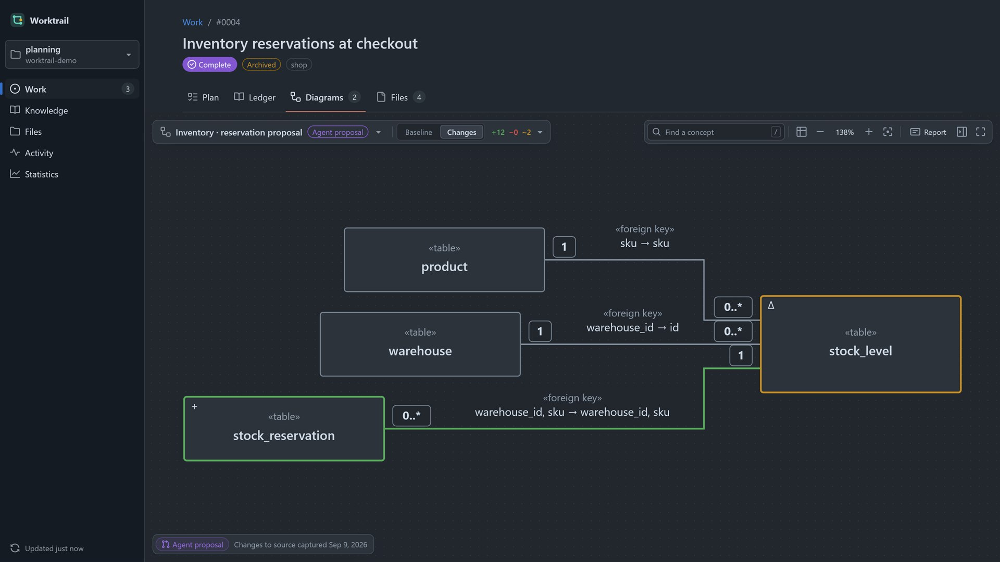

# Worktrail dashboard

A local React viewer for a planning repository. Browse active and archived work, selected plans, ledgers, glossary, ADRs, evidence, scoped knowledge, and recorded Git activity. Discuss changes with your agent in chat.

## Run locally

Requires Node.js 24 or newer, npm, and Git for planning history. From this directory, install dependencies once:

    npm ci

Start the dashboard with one command:

    npm run dev

Open [the local dashboard](http://127.0.0.1:4317). By default it reads the sibling planning folder two levels above this directory: a layout of workspace/worktrail/dashboard and workspace/planning. To read another repository:

    npm run dev -- --planning-dir "C:/path/to/planning"

Optional arguments: --port 4318 and --data-dir "C:/path/to/local-cache". For a built version, run npm run build once, then npm start with the same options. The server listens only on 127.0.0.1; nothing is hosted remotely. Stop it with Ctrl+C.

### Switching planning folders

The folder switcher at the top of the sidebar shows the open folder; its full path is in the tooltip. It lists recently opened folders, planning folders found nearby (the parent of the open folder and two levels below it, for example a sibling `worktrail-demo/planning`), and accepts any absolute path. A folder must contain a readable `planning.json` with schema version 1. Switching replaces the planning index, Atlas models and usage statistics, which are kept per folder, and returns to the work list. `--planning-dir` still chooses the first folder. Recent folders are kept in the data directory (`planning-roots.json`), never in planning.

The switch endpoints are `GET /api/planning-roots` and `POST /api/planning-root` with a JSON body of the form `{ "path": "…" }`. Like view events, the POST accepts only local, same-origin JSON requests.

## Records and progress

The reader uses planning.json schema version 1 and the planning workflow's [metadata contract](../skills/worktrail-bootstrap/assets/planning/PLANS.md). It follows each registered current_plan pointer. Work without a selected plan retains its original files and an explicit notice; filename order never selects a plan.

Registry locations use POSIX-relative paths. Safe aliases such as ./ prefixes and trailing slashes normalize in memory without rewriting records. Parent segments, absolute paths, backslashes, and duplicate retained work locations produce a clear registry error.

Path comparisons follow the connected folder's case and Unicode-normalization behavior, detected from existing entries without writing probe files. Filesystem aliases retain indexed document spelling and shared collector identities; distinct names remain separate.

Work IDs follow the shared work-0001 format. Explicit selected-plan pointers establish plan ownership; other documents belong to their most-specific registered location in both the viewer and consultation logger. Git activity uses the registry before deletions and after additions, preserving ownership when nested work is archived. Previously unregistered files can use their current registration without overriding established historical owners.

Design acceptance, implementation status, archive location, and known dates are displayed separately. Ledger prose supplies actual progress. Unknown dates stay unknown; invalid dates and chronology generate health errors. Recorded calendar durations are not engineering time. Git activity shows recent checkpoints, associating work through retained registry identities so archiving or renaming its folder preserves earlier activity. Filesystem and Git reads do not update plans or lifecycle state. Refresh manually or let the visible dashboard refresh every 20 seconds.

Contained Markdown links open their original records. External web references open separately; references outside the planning root are marked. Raw HTML is not executed. Text and common images render in the reader; other attachments can be downloaded. The text reader has a 4 MiB limit, with original downloads retained.

## Usage statistics

Two sources remain distinct: document opens in the browser and agent-reported consultation. Statistics show most/least recorded use, known task identities, recent consultation, and collection coverage. They do not measure whether the workflow improved an outcome. Zero recorded use does not mean a record was never read or should be removed.

The five planning skills use bootstrap's [consultation helper](../skills/worktrail-bootstrap/references/USAGE.md), which requires Python 3 with SQLite support and only the standard library. It writes while the dashboard is closed. No model calls, API keys, or paid API account are needed. Install the updated skills together using the repository's [installation instructions](../README.md#install-the-skills).

Usage is local, outside the planning and product repositories: ~/.cache/planning-dashboard/&lt;canonical-folder-hash&gt;/usage.sqlite. Both runtimes share this SQLite store. PLANNING_DASHBOARD_DATA_DIR or --data-dir overrides the cache base; both always add the folder hash so one override can safely serve several planning roots. Give the helper that same base directory. Moving the entire planning root changes the cache identity. Stable work IDs preserve per-document use through active/archive moves within the same root.

Events retain document identity, source, timestamp, known task/session IDs, available Git revision, and content hash. Bodies and transcripts are not stored. Browser views within 30 seconds of the same document/session are deduplicated. Agent reports deduplicate paths within each batch; they remain self-reported. Missing identities and incomplete collection are shown honestly. Failed database writes retain generic coverage markers alongside the database when that directory is writable; a wholly unavailable cache is disclosed in the task. Logging failure does not block reading or authorized implementation work.

## Verify

    npm test
    npm run build

Portable tests cover legacy records, explicit plan selection, path containment, statistics, and Python/Node interoperability while the dashboard is closed. A local-only test also reads the sibling workspace's actual planning registry when present; CI does not need private planning records. The repository's CI validates the dashboard and planning helper tests.

## Viewer conventions

The interface uses [GitHub Primer](https://primer.style/product/components/underline-nav/) Dark dimmed tokens and Octicons, system typography, and GitHub-like Markdown presentation. It is dark-only. The sidebar holds the folder switcher, a record-health indicator, navigation (Work, Knowledge, Files, Activity, Statistics) and a refresh control. Repository filters sit in each list's toolbar.

Each work row shows one status, styled like a GitHub issue: Not started, In progress, Partially done, Complete, Blocked (with the reason), Draft plan, Superseded or Abandoned. The design status appears only when it adds information. Rows also show the reported current focus, the repositories, a diagram count and a relative date.

A work page has a GitHub-repository layout: **Plan | Ledger | Diagrams | Files** tabs with an About sidebar holding the reported status (current, next, blocked), known dates, recent commits and any record-health notes for that work. An explicit file URL always wins: the plan and root ledger open in their tabs, and any other file opens in Files with a tree and reader. Otherwise work opens the plan before implementation and the root ledger for in-progress, partial or complete implementation, falling back to the explicit selected plan when no ledger exists.

The root ledger's optional version-1 status header reports current, next, blocked, and updated values under the shared [contract](../skills/worktrail-bootstrap/assets/planning/PLANS.md#ledger-status-version-1). The viewer never infers current activity from historical narrative. Skills update that header at meaningful transitions; it is reported status, not continuous live telemetry. Missing or invalid status remains unknown and the original body stays readable.
## Atlas diagrams

Diagrams belong to their plan. Each work folder is its own Atlas workspace (`<work>/.atlas/models`), so archiving or moving the folder carries its diagrams along; model editing stays with the agent. Models in the older shared workspace at `<planning>/.atlas/models` remain readable and are matched by `workId`. If the same model exists in both places, the work folder's copy wins. `--atlas-dir /path/to/workspace` connects a different legacy workspace for the folder given on the command line.

A plan shows an inline diagram card under each heading that a model references through its context records. Records give `path` relative to the work folder (`plan.md`); older paths relative to the planning root still resolve. A card shows the diagram title, its provenance, and the linked elements; it opens the **Diagrams** tab focused on that element. References without a matching heading are listed at the top of the document.

On the Diagrams tab, the Atlas canvas takes the full width and remaining height, with its controls floating over the grid. The model picker sits at the start of the canvas toolbar, and the canvas's full-view toggle covers the whole app (Esc exits). The picker groups models by provenance, using the same wording and colours as Atlas (`describeProvenance`; a test keeps the dashboard's copy in step). **Generated from code** and **Generated from database** mark captured snapshots, with source, capture date and coverage. **Agent proposal** marks proposed changes to a captured source, and **Agent-authored** marks conceptual or structural models. Each model lists the plan sections it explains.

The tab checks model revision summaries every two seconds while visible. Model, backlink and retry polling pauses in background tabs and resumes on return. Planning scope reads are coalesced and cached for 20 seconds, invalidated by registry changes; a manual records refresh reloads that index. Valid authored revisions update the view, preserving camera/selection where their identities remain. Invalid or unrecorded edits retain the last valid diagram and display an error. Model-load failures keep their own warning and retry with bounded backoff until that revision loads; successful catalog polls do not dismiss them. Captured sources are never recaptured by polling. Source dates, coverage and imported claims stay visible in the model metadata.

An element's retained plan/glossary/decision passages appear in its inspector. **Open plan** follows an indexed record and optional `section` heading. The referenced document also exposes links back into the diagram. Shared knowledge pages aggregate backlinks from their registered work items. References outside the indexed work and shared knowledge are unavailable; retained passage text still helps explain the model offline. Code evidence remains pinned and uses Atlas's syntax-highlighted snippets.

The dashboard installs the canonical Atlas package from `vendor/ontouml-atlas-<source-commit>.tgz`. Its manifest records the source commit and SHA-256. To update it from a clean, committed Atlas checkout, run `npm run atlas:package -- /path/to/atlas`, then `npm install` and the checks. CI needs no sibling Atlas checkout. See [Atlas planning guidance](../skills/worktrail-atlas/SKILL.md).

**Report** opens authored walkthroughs, checked finite instances/counterexamples, guided SVG diagrams, selected glossary/evidence and print presentation. It returns to the existing diagram without discarding its camera/selection. Model state, source scopes and imported claims remain visible; learning checks do not establish domain accuracy.

The installed consumer CI also runs `node scripts/check-review.mjs`, testing semantic review and HTML export/reopen without the Atlas source checkout. Revision-labelled review files are retained as workflow artifacts. `npm run release:assemble` builds a versioned planning/dashboard source ZIP from the committed Git tree with its pinned Atlas tarball; `npm run check:release` verifies hashes and repeatable packaging without publishing. See the repository [contribution guide](../CONTRIBUTING.md) and [changelog](../CHANGELOG.md). Models in a user's local `.atlas` workspace are excluded from distribution.
