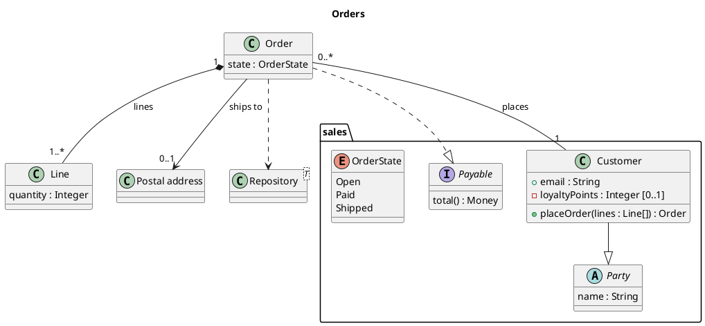
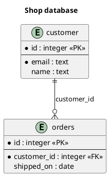
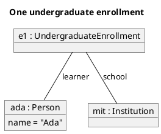

# Diagrams

A diagram is a file in a work item, written in Atlas's subset of [PlantUML](https://plantuml.com/class-diagram): a class diagram of concepts or code, an entity diagram of a database, or an object diagram of example instances. Agents write and edit diagrams like any other file in the planning folder; `atlas check` (which the hooks run after every edit) reports what is wrong, line by line. Atlas draws diagrams with its own viewer, in the app, in plan exports and in offline HTML files.

Because the subset is PlantUML, any diagram Atlas accepts also renders in PlantUML. The reverse does not hold: Atlas lays diagrams out and styles them itself, so the subset has no syntax for layout or appearance, and anything outside it is an error rather than something silently skipped.

## Where diagrams live

Every `*.puml` file in a work folder is one of its diagrams, usually under `diagrams/`. A plan links a diagram with an ordinary Markdown link under the heading the diagram explains, and the app shows the diagram's card there:

```md
## Data model

Orders keep their lines and the address they ship to.
[Order model](diagrams/orders.puml)
```

A fragment names one element, which the card shows as a chip and the viewer focuses: `[the order](diagrams/orders.puml#Order)`. It is the element's PlantUML name, or a class's display name, URL-encoded (`#Order%20Item`). Any Markdown document of the work item can link its diagrams this way, such as the plan or the glossary; `atlas check` warns about a diagram no document links. A diagram's history is its file's history in the planning folder's Git.

## The subset

A file holds one diagram between `@startuml` and `@enduml`, each on a line of its own, with an optional `title` line. Lines starting with `'` are comments.

### Class diagrams



- **Elements** are `class`, `abstract class`, `interface` and `enum`, each with a body in braces or without one. An element's name is its identity; a name with spaces or other characters is a display name with an alias, `class "Postal address" as Address`. Names are unique in the diagram, across packages. Classes and interfaces may take type parameters, `class Repository<T>`.
- **Attributes** are `name : Type`, with an optional multiplicity, `[0..1]`, and an optional visibility in front: `+` public, `-` private, `#` protected, `~` package.
- **Operations** are `name(parameters)` with an optional `: ReturnType` and visibility.
- **Enum literals** are a name on each line.
- **Packages** are `package name {` … `}` and nest.
- **Relations** run between declared elements, with spaces around the arrow:

  | Written     | Meaning                                                         |
  | ----------- | --------------------------------------------------------------- |
  | `A -- B`    | Association                                                     |
  | `A --> B`   | Association navigable to B                                      |
  | `A --\|> B` | A inherits B (classes from classes, interfaces from interfaces) |
  | `A ..\|> B` | A implements the interface B                                    |
  | `A o-- B`   | Aggregation: A is the whole, B the part                         |
  | `A *-- B`   | Composition: A is the whole, B the part                         |
  | `A ..> B`   | Dependency                                                      |

  The mirrored arrows (`<--`, `<|--`, `<|..`, `--o`, `--*`, `<..`) mean the same with the ends swapped. Multiplicities go in quotes beside their end, `"1"`, `"0..1"`, `"0..*"`, `"1..*"` or `"2..5"`, and a label after a colon. Inheritance has neither.

### Entity diagrams



An entity lists its columns as `name : type`, a mandatory column with `*` in front, its primary key columns marked `<<PK>>` above one `--` separator and its other columns below it (an entity without a key has no separator), and foreign key columns marked `<<FK>>`. Entities are joined by crow's-foot relations whose ends give the counts: `|o` and `o|` zero or one, `||` exactly one, `}o` and `o{` zero or more, `}|` and `|{` one or more, the left foot on the left. A relation's label lists the foreign key columns it stands for, and every `<<FK>>` column is named by a relation.

### Object diagrams



An object is `object "name : Class" as id` (several classes separated by commas), with slot values `name = value` in its body, and objects are linked with `--` or `-->`. Object diagrams are [scenarios](#scenarios) of a class diagram.

### What Atlas rejects, and why

| Rejected                                                                                                                                                                                    | Why                                                                                                                                                                                                                                    |
| ------------------------------------------------------------------------------------------------------------------------------------------------------------------------------------------- | -------------------------------------------------------------------------------------------------------------------------------------------------------------------------------------------------------------------------------------- |
| Directions in arrows (`-up->`, `-left->`), `left to right direction`, longer arrows (`--->`), `[hidden]` links                                                                              | Atlas lays diagrams out itself.                                                                                                                                                                                                        |
| Colours and styles (`#red`, `#line:`, `skinparam`, `<style>`, `!theme`), `scale`                                                                                                            | Atlas styles diagrams itself, alike everywhere.                                                                                                                                                                                        |
| `together`, `hide`, `show`, `remove`                                                                                                                                                        | Atlas decides what a diagram shows; leave out what should not be in it.                                                                                                                                                                |
| Notes, legends, headers, footers, captions, multi-line titles                                                                                                                               | The rationale belongs in the plan, under the heading that links the diagram.                                                                                                                                                           |
| Stereotypes other than `<<PK>>` and `<<FK>>` on entity columns (on elements, in members, labels and titles), member modifiers such as `{static}` anywhere in a member                       | Conceptual diagrams are plain UML; the subset has no stereotype vocabulary.                                                                                                                                                            |
| Creole and HTML formatting (`**bold**`, `//italic//`, `<b>`, links, icons, sprites)                                                                                                         | Diagrams are plain text. In attributes, operations, slot values and labels only a pair of markers is formatting, as PlantUML reads it, and `__` never is, so `List<U>`, one `//` in a URL or a column `customer__id` stays as written. |
| A line that ends in `\`, a title of symbols only (`title <`), a name with an emoji or another character beyond the Basic Multilingual Plane, an enum literal that starts and ends with `__` | PlantUML would join the line with the next, fail to read the title, fail to relate the element (give it a display name instead), or read the literal as a separator.                                                                   |
| The preprocessor (`!include`, `!define`, `!function`, variables)                                                                                                                            | A diagram is read as written, without running anything.                                                                                                                                                                                |
| Every other diagram type (sequence, activity, component, deployment, state, use case, C4 and the rest), and mixing class, entity and object elements in one file                            | Atlas draws class, entity and object diagrams, one kind per file.                                                                                                                                                                      |

Each rejected line is reported with its line and column and what to write instead.

### Model rules

`atlas check` also checks what the diagram says: element and member names are unique, relations join declared elements (Atlas never creates an element from a relation), multiplicities are valid, a class implements only interfaces and inherits only classes (an interface only interfaces), enums take no part in inheritance, inheritance has no cycles, and foreign key columns are named by their relations.

## `' atlas` comments

PlantUML ignores comments, so facts Atlas needs are `' atlas` comment lines. The ones at the top of a diagram describe the whole file:

| Line                                              | Meaning                                                                                                                            |
| ------------------------------------------------- | ---------------------------------------------------------------------------------------------------------------------------------- |
| `' atlas capture {json}`                          | The file is a [capture](#captures) Atlas wrote from code or a database.                                                            |
| `' atlas fingerprint <sha256>`                    | The capture's fingerprint. Atlas writes it; a capture whose text no longer matches it was edited.                                  |
| `' atlas proposal <path>`                         | The file is a [proposal](#proposals) starting from the diagram at `path`, relative to this file.                                   |
| `' atlas compares <path>`                         | A capture that compares with an earlier capture, to show the system [before and after](#before-and-after) a plan's implementation. |
| `' atlas scenario <path> expected valid\|invalid` | An object diagram of example instances of the class diagram at `path`, and whether it should hold.                                 |

Directly above an element, member or relation, more describe it, each at most once:

| Line                         | Meaning                                                                                                                                                                                    |
| ---------------------------- | ------------------------------------------------------------------------------------------------------------------------------------------------------------------------------------------ |
| `' atlas description <text>` | What it is for, in one short sentence of plain text (at most 280 characters) on the same line. Classes, interfaces, enums, entities, objects and their members take one; relations do not. |
| `' atlas evidence {json}`    | Where it is declared: `file` (required), `line`, `endLine`, `repo`, `commit`, `url` (`http` or `https`), `title` and `claim`. The details show it as its source.                           |
| `' atlas snippet {json}`     | A short excerpt of its source, at most twelve lines: `language`, `code`, and optionally `startLine` and `file`. The viewer highlights it.                                                  |

Any other `' atlas` word is an error, so a typo is caught; write remarks as plain `'` comments.

### Descriptions

The subset has no notes, so a description is how a diagram says what an element or member is for:

```plantuml
' atlas description A place a window shows: a project's plans, a plan, a diagram or a file.
entity place {
  *id : integer <<PK>>
  --
  ' atlas description Empty for a project's plans.
  target : text
}
```

The viewer shows a description in the element's details, under its name or beside the member, and as its tooltip on the canvas. A proposal that adds, changes or removes a description changes that element. Write one sentence of purpose where the name does not say it, such as for each table of a database diagram; why the design is so is rationale, which belongs in the plan. `atlas check` reports a description that is empty, longer than 280 characters, formatted (`**bold**`, `<b>`), repeated for one element, or not directly above a class, interface, enum, entity, object or member.

## Captures

A capture is a diagram Atlas generates from code, through its compiler, or from a database's catalog: a class diagram of TypeScript or Java declarations, or an entity diagram of SQLite, PostgreSQL or local D1 tables. A capture is frozen: `atlas check` reports one that was edited after Atlas wrote it. To show a change, write a proposal; to refresh a capture, capture again.

`atlas capture` captures what a source configuration file describes and writes the diagram into a work item:

```sh
atlas capture capture.json --work work-0012                 # diagrams/<identity>-<date>.puml
atlas capture capture.json --work work-0012 --name before   # diagrams/before.puml
atlas capture capture.json --out schema.puml                # any file
```

The configuration is JSON whose paths are relative to it, so it usually sits in the repository it captures:

```json
{
  "formatVersion": 1,
  "adapter": "typescript",
  "identity": "shop",
  "title": "Shop classes",
  "projects": [{ "identity": "api", "path": ".", "tsconfig": "tsconfig.json" }]
}
```

| Adapter      | Configuration                                                                                                                   |
| ------------ | ------------------------------------------------------------------------------------------------------------------------------- |
| `typescript` | `projects`: up to eight, each with `identity`, `path` and an optional `tsconfig` (default `tsconfig.json`) and `repositoryUrl`. |
| `java`       | `projects`: each with `identity`, `path`, the source `files` and an optional `classpath`.                                       |
| `sqlite`     | `file`: the database file; optional `tables`.                                                                                   |
| `postgresql` | `connectionEnv`: the environment variable holding the connection; `schemas`.                                                    |
| `d1-local`   | `config`: the Wrangler configuration; `database`: the binding; optional `tables` and `wranglerJS`.                              |

Every adapter takes an `identity` (letters, numbers, dots, colons and dashes), an optional `title`, and the database adapters optional `references`: files such as migrations that describe a table, cited as its evidence. The schemas are [code-source](../packages/diagrams/schemas/code-source-schema.json) and [database-source](../packages/diagrams/schemas/database-source-schema.json); [code capture](code-capture.md) and [database capture](database-capture.md) describe each adapter's prerequisites, fidelity and limits.

The command refuses to replace an existing file unless given `--force`. It prints the capture's summary as JSON (`file`, `work`, `title`, `kind`, `compares`, `capturedAt`, `adapter`, `coverage`, the number of `diagnostics`, `elements` and `relations`) and exits 0, 1 when the capture fails or is refused (the reason, starting with its code such as `CAPTURE_CONFIG` or `CAPTURE_PREREQUISITE`, on stderr), and 2 on usage errors. `--planning-dir` names the planning folder when the current checkout does not find it.

### What a capture holds

The `' atlas capture` header records the capture's date (`capturedAt`), the `adapter` and its version (and the compiler's), the `source` (its kind, identity and scope, and for code each project's Git revision and the fingerprints of its files, configuration and dependencies), the `coverage` (`complete`, or `partial` with the diagnostics that say what was left out), how it was kept consistent, and its `limitations`. Each element carries its evidence, and code elements a snippet of their declaration; each member carries the line it is declared on. A code declaration or member with a documentation comment (JSDoc or Javadoc) is described by the comment's first sentence, without inline tags and HTML; one longer than a description may be is left out. Database captures carry no descriptions. A link to the source is pinned to a commit only when the files are as that commit has them.

Code becomes a class diagram: classes, abstract classes, interfaces, enums (with their constants) and records, with their fields and their methods and constructors, and visibility where it is declared. Type aliases are classes whose snippet shows their definition. `extends` and `implements` become inheritance and implementation; a TypeScript class that implements a class, or an interface that extends one, has no UML arrow and becomes a dependency labelled `implements` or `extends`. Every other declared type use is a dependency, `..>`. A TypeScript project's folders and Java's packages become packages.

A database becomes an entity diagram: each table with its columns, mandatory columns, primary key and foreign keys, each foreign key a crow's-foot relation labelled with its columns. A count Atlas cannot establish is drawn as loosely as a crow's foot allows, and the diagnostics say why. Defaults, unique keys, indexes, checks and triggers are in each table's snippet, its SQL.

Names become PlantUML names the same way every time, so the same source captured again gives the same diagram apart from its date and fingerprint, and a later capture compares with an earlier one element by element. A name that is not a PlantUML name has its other characters replaced with `_` and keeps its display name; a name two elements share is told apart by its owner or package, else numbered. Text PlantUML would read as formatting, a stereotype or a modifier (`<<x>>`, `{static}`) is broken up with a space, and a type that would end its line in `\` is wrapped in parentheses.

## Proposals

A proposal shows an intended change. Copy the capture (or any diagram) to a new file, replace its `' atlas capture` and `' atlas fingerprint` lines with `' atlas proposal <path of the capture>`, and edit it like any diagram. Atlas compares the proposal with its baseline by name: an element is its name, a member `Element.name` (an operation also by its parameters), a relation its kind, ends and label. Renaming an element is therefore removing one and adding another. A proposal never names itself, or a diagram whose own baselines lead back to it; `atlas check` reports such a cycle. The evidence lines copied from the capture can stay; a new class can say where it is meant to go with an `' atlas evidence {"file": "src/vault.ts"}` line above it.

Several proposals of one capture are alternatives, for when the agent is not sure which design fits. A capture, its proposals and later captures compared with it form a family that the viewer lays out once, so switching among them keeps every class in its place. A proposal opens in its change view: the proposal with what it removes kept in place, every change marked, and the list of changes beside it.

## Before and after

When a work item's diagrams include captures, `atlas-implement` captures again when implementation starts and at its end, so the work item shows the system before and after:

```sh
atlas capture capture.json --work work-0012 --name before
# … implement the plan …
atlas capture capture.json --work work-0012 --name after --compares before.puml
```

`--compares` takes the earlier capture's path, from the current folder or from the folder the new capture goes to, and records it in an `' atlas compares` line. The earlier file must be another capture of the same kind, not the file being written and not one that compares with it. The later capture opens in its change view, compared with the earlier one.

## Scenarios

A scenario is an object diagram of example instances that says whether it should hold against a class diagram: `' atlas scenario ../enrollment.puml expected valid` (or `invalid`). Each object names its classes, its slots are attributes of those classes, and each link is labelled with the name of the relation it instantiates. `atlas check` assesses the scenario and reports one that does not turn out as expected.

The assessment counts an object as an instance of its classes, of everything they inherit and of the interfaces they implement, requires an object of an abstract class or an interface to be an instance of a concrete class too, and checks every relation's multiplicities at both ends for the objects shown. It is a closed-world check of the instances listed, not a proof that the model is right. A relation without counts or a dependency cannot be assessed; such a scenario is a warning, not an error. A class diagram shows its scenarios, assessed, under **Understand the model** in the viewer.

## In the viewer

The viewer draws a diagram's elements and relations with its own orthogonal layout, shows each element's details, its source excerpt and where it is declared, and offers SVG, PlantUML and ZIP downloads. [Viewer](viewer.md) describes its behaviour, and [embedding](embedding.md) the Node library and React panel the app uses.
