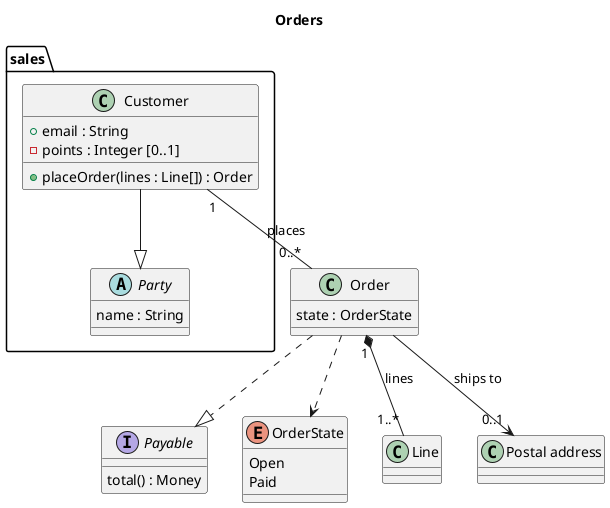

# Diagrams

Diagrams are `.puml` files in a work item, in Coord's subset of PlantUML. Write and edit them as ordinary files; there are no diagram tools. After each edit, Coord checks the diagram and hands back what is wrong, line by line. The full guide is `docs/diagrams.md` in the Coord repository.

## When to make one

Make a diagram when the work settles domain concepts, boundaries or data structure and a picture would help the user and you understand it the same way; plain UI or tooling work gets none. When the work changes existing code or a database, capture it and build proposals on the capture, so the diagram starts from the real structure instead of a remembered one. A major change to a schema or a model's structure (tables or entities added, removed, split or merged, or their relations changed) gets a `before` and an `after` capture even when no diagram was asked for: they record what the work changed.

## Where it goes

Put diagrams under the work folder's `diagrams/`. Link each from the plan with an ordinary Markdown link in the sentence it explains: `[Order model](diagrams/orders.puml)`, or `diagrams/orders.puml#Order` for one element (its PlantUML name, or a class's display name URL-encoded). The rationale goes in the plan, not in the diagram.

## Syntax



- One diagram per file: a class diagram (`class`, `abstract class`, `interface`, `enum`), an entity diagram (`entity`) or an object diagram (`object`). Never mix kinds.
- Put elements that belong together in a `package`: Coord lays each package out as a group, drawn as a region with its name, with room between the groups, as a person would draw them. Without packages it finds the groups from the relations. A diagram of a few elements needs none.
- Names are identities and unique across packages. Use `class "Display name" as Name` for names with spaces.
- Attributes `name : Type [0..1]`; operations `name(params) : Type`; visibility `+ - # ~`.
- Relations between declared elements, spaces around the arrow: `--` association, `-->` navigable, `--|>` inherits (classes from classes, interfaces from interfaces), `..|>` implements an interface, `o--` aggregation and `*--` composition (whole on the left), `..>` dependency. Quoted multiplicities at either end, label after `:`. Inheritance takes neither.
- Entities: the `*name : type <<PK>>` columns above one `--` line and all other columns below it (no `--` without a key), `<<FK>>` on foreign keys; crow's-foot relations `customer ||--o{ orders : customer_id` whose label lists the FK columns as named. Feet: `|o`/`o|` `0..1`, `||` `1`, `}o`/`o{` `0..*`, `}|`/`|{` `1..*`.
- Objects: `object "ada : Person" as ada {`, then slots such as `name = "Ada"` each on its own line, then `}`; links `e1 -- ada : learner` labelled with the relation's name.
- A body's `{` ends the declaration line and its `}` stands on a line of its own.

Rejected, with the reason in the error: arrow directions and lengths (`-up->`, `--->`), `left to right direction`, `[hidden]`, colours, `skinparam`, `<style>`, `!theme`, `hide`/`show`/`together`, notes, legends, headers, footers, stereotypes other than `<<PK>>`/`<<FK>>` (also in members, labels and titles), member modifiers such as `{static}` anywhere in a member, Creole or HTML formatting, the preprocessor (`!include`, `!define`), and every other diagram type. Coord lays out and styles diagrams itself. Also rejected because PlantUML would misread them: a line ending in `\` (it joins the next line), a title of symbols only, a name with an emoji or another character beyond the Basic Multilingual Plane (use a display name), and an enum literal that starts and ends with `__` (a separator).

## `' coord` lines

At the top of the file:

- `' coord proposal <path>`: this file is a proposal of the diagram at `path` (relative to this file), never itself or a diagram whose baselines lead back to it.
- `' coord scenario <path> expected valid` (or `invalid`): this object diagram exemplifies the class diagram at `path`.
- `' coord capture {json}`, `' coord fingerprint …` and `' coord compares <path>`: written by `coord capture`; never write or edit them.

Directly above an element, member or relation: `' coord evidence {"file": "src/x.ts", "line": 12}` (where it is declared; a `url` starts with `http://` or `https://`) and `' coord snippet {"language": "typescript", "code": "…"}` (at most twelve lines). Other `' coord` words are errors; use plain `'` comments for remarks.

Directly above a class, interface, enum, entity, object or member (not a relation): `' coord description <text>`, one short sentence of what it is for, in plain text on that line (at most 280 characters, no formatting). The viewer shows it as the element's tooltip, and a proposal that changes it changes the element. Describe what a reader cannot tell from the name, such as each table of a database diagram; skip the obvious. Why it is designed so is rationale and stays in the plan.

```plantuml
' coord description A tab of a window, showing something of one project.
entity tab {
  *id : integer <<PK>>
  --
  ' coord description Empty for a project page.
  target : text
}
```

## Captures

Capture with a source configuration file (JSON, paths relative to it, usually kept in the repository it captures):

```json
{
  "formatVersion": 1,
  "adapter": "typescript",
  "identity": "shop",
  "projects": [{ "identity": "api", "path": "." }]
}
```

Adapters: `typescript` (`projects` with `path`, optional `tsconfig`), `java` (`projects` with `path` and `files`, optional `classpath`; needs a JDK 21 or newer), `sqlite` (`file`), `postgresql` (`connectionEnv`, `schemas`), `d1-local` (`config`, `database`).

```sh
coord capture capture.json --work work-0012 --name before
coord capture capture.json --work work-0012 --name after --compares before.puml
```

Without `--name` the file is `diagrams/<identity>-<date>.puml`; `--out <file>` writes elsewhere; an existing file needs `--force`. The command prints a JSON summary; exit 1 means the capture failed or was refused (the reason is on stderr). A capture is frozen: never edit it. Before work changes a schema or a model's structure in a major way, capture `before`, writing the source configuration first if there is none; when the change is made, capture `after --compares before.puml`. Link the pair from the plan, where it says what changed.

## Proposals

Copy the capture to a new file, replace its `' coord capture` and `' coord fingerprint` lines with `' coord proposal <capture file>`, then edit. Coord compares by name, so keep the names of what stays; a rename shows as a removal and an addition. Keep the copied evidence lines; give a new class `' coord evidence {"file": "src/new.ts"}` to say where it goes. For alternatives, write one proposal per option from the same capture and give each a `title`.

## Scenarios

Write an object diagram with `' coord scenario ../model.puml expected valid` (or `invalid`) to check an example against a class diagram. Objects name their classes, slots must be attributes of those classes, links carry the relation's name. The check covers inherited classes and implemented interfaces, abstract classes and interfaces (an object needs a concrete class) and multiplicities at both ends of every relation; an example Coord cannot fully assess is a warning.
